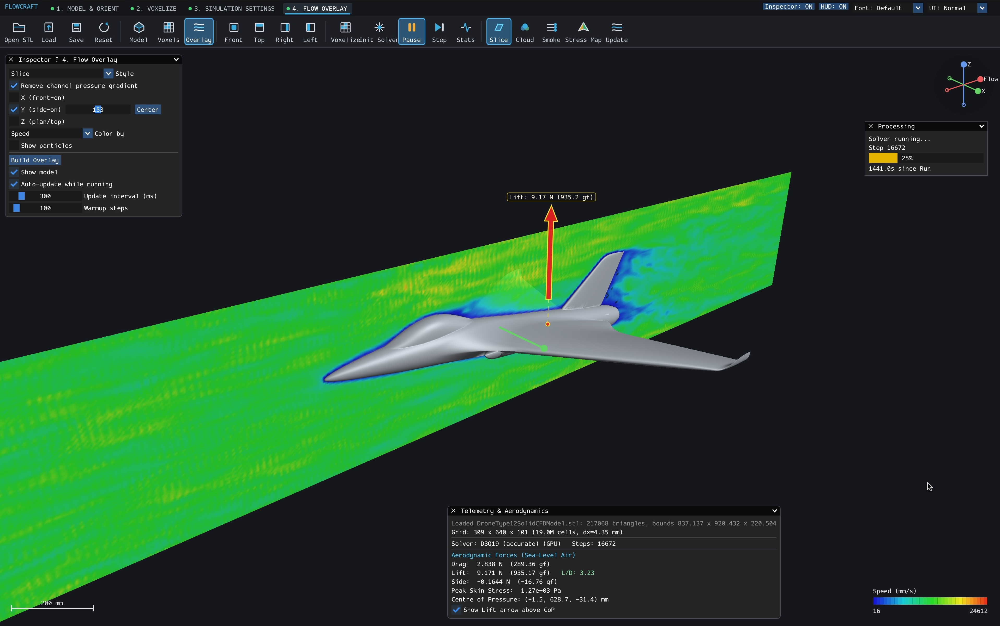
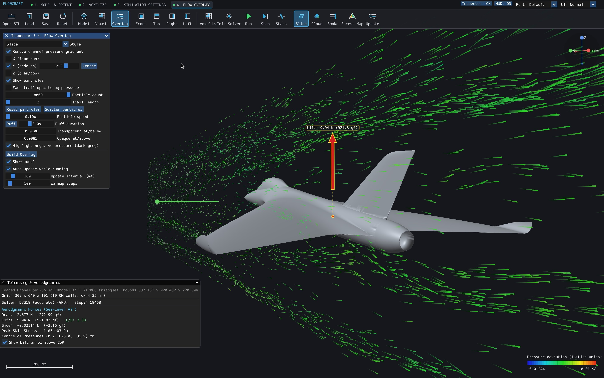
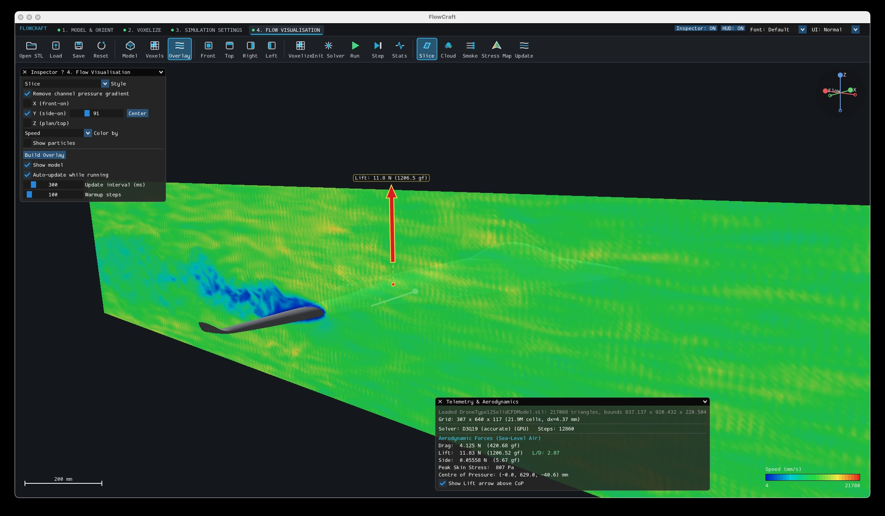
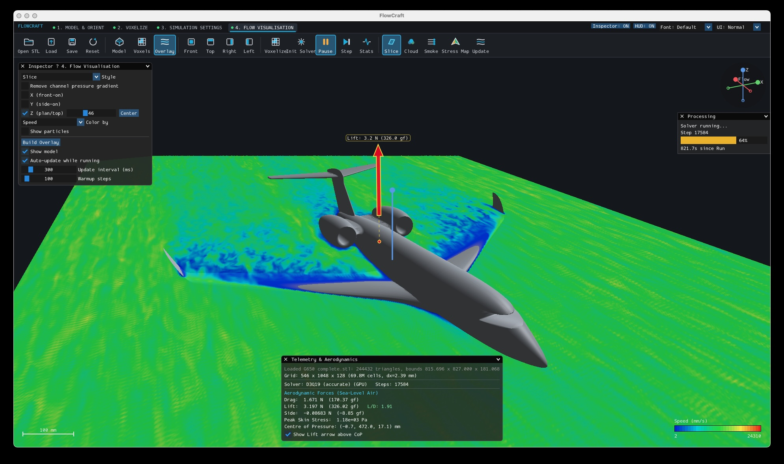
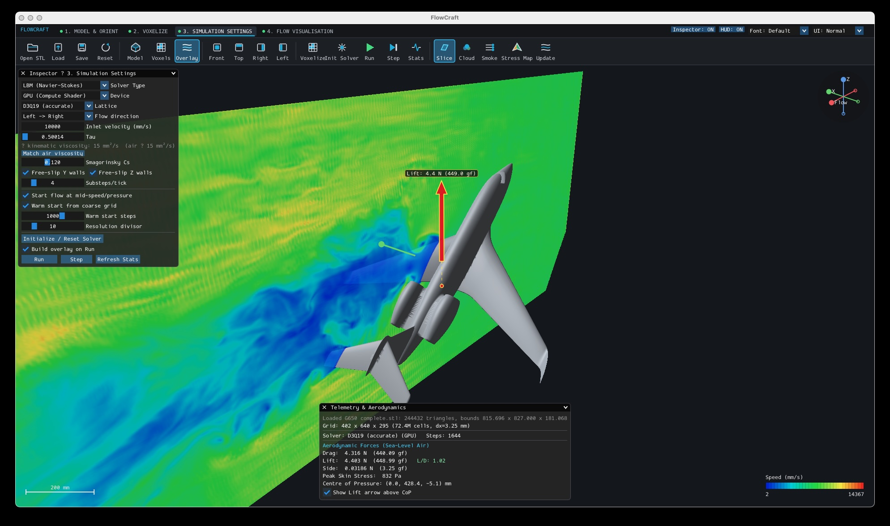
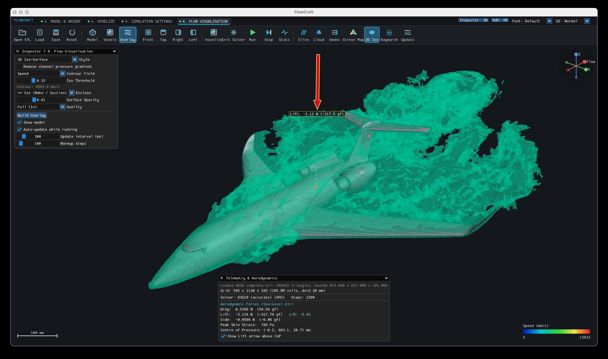
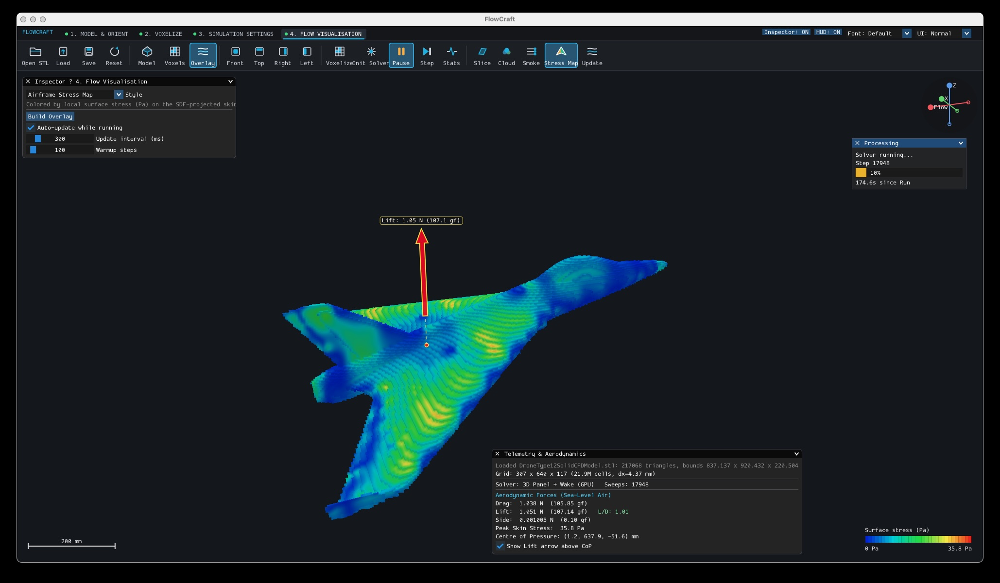

# FlowCraft

### Background
Around a year ago I purchased a fantastic book called "Shaping the Vulcan" by Stephen Liddle, which covers the postwar period of aerodynamic research by the British aircraft industry. 
 

This sparked a fascination as to how aircraft wings and fluids interact to generate lift. 
Despite (or perhaps because of) my lack of experience in this subject and because I don't have space to build a real wind tunnel, I decided to create an application that can visualise these fluid flows in a more interesting way than a bunch of graphs on a spreadsheet. 

FlowCraft allows you to load any 3D object (in STL format), and then using the Lattice Boltzmann Method (D3Q19 and D3Q15) be able to visualise in realtime (as your machine allows) the fluid flow around that object.  The computation can be run on your GPU or CPU, but you will need a very powerful machine either way. The GPU backend tends to run faster, but is mostly limited by the memory available to the GPU. If your machine is lacking resources, I've included a Panel Method backend (and also a Potential Flow solver, if you really really really don't have much computing power), which is less computationally expensive, but isn't as accurate...
My relatively old MacStudio Ultra can run the LBM GPU visualisation for ~220 million cell lattice at around 1 frame per second.

Due to the large RAM and compute resources required for CFD, I'm not sure how useful this really is as a desktop application but it is fun.  
<b>How accurate is this?</b> I don't know, I'm not an aerodynamicist, and I'm extremely new the Navier–Stokes equations. 
<b>Can I use it to test my new Airbus A380 killer?</b> I don't know, I'm not an aerodynamicist, but given how much Compute and RAM resources are required to process a small 1000mm model (the flow doesn't really stabilise until around 1000 steps), so I would say probably not. 
<b>Why didn't you include x, y, and z features and make this actually useful?</b> I don't know, I'm not an aerodynamicist. I just wanted to see some pretty 3D animations of fluid flows around my CAD models using my desktop computer.  

For more serious aero-modelling work, I would suggest using the [XFLR5 application](https://www.flow5.tech/xflr5/xflr5.html), but sadly it looks like that project ended in June 2026. I've tried to add some aero polar plots to my slice visualiser to assist with Airfoil design, I will listen to feedback as to how to make this more useful (currently available as an option in the simulation settings).

Several visualisations are available; "smoke" trails, colour map (pressure/speed), Iso-Surface, and voxel space.

As a nice bonus, the visualiser can also show pressure stress on the airframe, which can help when designing a model to see where extra support might be needed. 

Why the name FlowCraft, all apps seem to be called something Craft now :-)

## License

FlowCraft is licensed under the [GNU Lesser General Public License v3.0 (LGPL-3.0)](LICENSE).

Third-party libraries and assets retain their respective licenses and copyrights:
- **Dear ImGui** (`FlowCraft/ThirdParty/imgui`) — MIT License.
- **SDL3** — zlib License.
- *Shaping the Vulcan* book cover image (`ShapingTheVulcan.jpg`) — property of its respective copyright holder, shown for commentary/reference.

